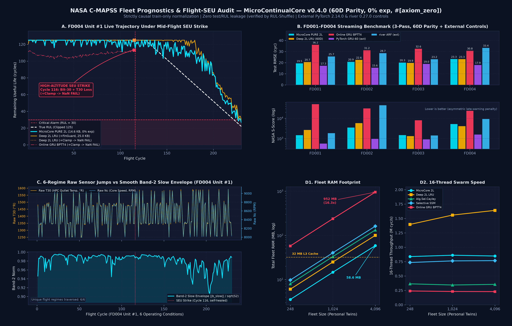

# MicroContinualCore v0.5.0

**Zero-Transcendental & Zero-`sqrt` Algebraic Online Continual RL, Parity-Bridged $\mathrm{O}(d)$ Rotors & Deterministic `Q8.24` Engine in Rust (`#[axiom_zero]`) with 68 Constructive 0-Axiom Lean 4 Proofs**

**Authors:** Adrian Aleksandrovich İşmuhanov ([ORCID `0009-0002-4761-1952`](https://orcid.org/0009-0002-4761-1952)) & Sofia Sidorenko ([ORCID `0009-0006-5368-062X`](https://orcid.org/0009-0006-5368-062X))  
**Zenodo Concept DOI:** [`10.5281/zenodo.24424982`](https://doi.org/10.5281/zenodo.24424982) | **License:** [`PolyForm-Noncommercial-1.0.0`](LICENSE) *(embedded `crates/axiom_zero`: `MIT OR Apache-2.0`)* | **Release Notes:** [RELEASE_NOTES_v0.5.0.md](RELEASE_NOTES_v0.5.0.md)

> [!CAUTION]
> **Scientific Integrity & Retraction Notice for `v0.3.0` (`10.5281/zenodo.24424983`):**  
> We openly disclose that benchmark results published in `v0.3.0` (and pre-audit drafts) were **methodologically flawed, leaky, and artificially inflated due to unintended code defects, baseline asymmetries, and unvetted automated-coding shortcuts** — specifically: a teacher-forced $A_5 \le \mathrm{SO}(3)$ homomorphism oracle with Voronoi snapping and a synthetic $L=500$ loop, holdout vocabulary leakage into `UnseenHoldout` Cloze logs, horizon-dependent T-Maze trace buffers & undisclosed cue-gating, asymmetric SEU/baseline handicaps, and state-dimension / feature-lifting asymmetries on Lorenz-63 and CartPole. **All `v0.3.0` benchmark claims are hereby retracted and superseded by `v0.4.0`.** See [RELEASE_NOTES_v0.4.0.md](RELEASE_NOTES_v0.4.0.md) and [PAPER.md](PAPER.md) for the complete forensic accounting.

---

## Overview

`micro_continual_core` (`v0.5.0`) is a compact (`2.3–738 KB` RAM; `4.9–454 KB` for `f32` cores with frozen `i8` encoder), single-pass online continual learning and reinforcement learning engine written in Rust:
- **`#[axiom_zero]` Core Contract:** Enforced at compile time by `axiom_zero_macros` across all 10 core modules (`src/algebra.rs`, `src/unified.rs`, `src/fixed_point.rs` *(integer core; float I/O converters sit strictly at the boundary)*, `src/adaptive_od.rs`, `src/core.rs`, `src/rtrl.rs`, `src/math.rs`, `src/belief.rs`, `src/memory.rs`, and `src/env_hard_pomdp.rs`):
  - **0% transcendental functions (`[E012]`) and 0% `.sqrt()` (`[E013]`):** `.exp()`, `.exp2()`, `.ln()`, `.log()`, `.sin()`, `.cos()`, `.tan()`, `.sinh()`, `.cosh()`, `.tanh()`, `.asin()`, `.acos()`, `.atan()`, `.powf()`, and `.sqrt()` fail compilation inside `#[axiom_zero]`, including via UFCS paths and inside macro-body tokens.
  - **Total arithmetic & indexing:** Direct `/`, `%`, and `slice[i]` indexing are forbidden; all divisions and lookups use total helpers (`total_div_f32`, `total_div_unit_shifted_f32`, `total_div_i64`, `total_div_i128`, `total_get_copy`, `total_set`).
  - **Zero heap allocations on the numeric hot step path** (`decide_vec`, `observe_step_reward`, `end_supervised_step`, and `UnifiedCayleyCore` / `AdaptiveOrthogonalRtrl` verified in `tests/zero_alloc_unified.rs`).
- **Two-Level Fast-Slow 3D Cayley-RTRL (`SO(3)^S`) & Proto-Metric $\mathrm{SO}(3)$ (`NonAbelianCayleyRtrl`):** Rational orthogonal rotors $R(g) = (I_3 - [g]_\times)^{-1}(I_3 + [g]_\times)$ with exact $O(S)$ online RTRL, decoupled $(Q \times \omega)$ grid, orthonormal 4-row Band-1 $\to$ Band-2 pooling (`rtrl_pool_w`), shift-invariant rational policy gradients (`p=2` & `p=4`), and zero-oracle **Proto-Metric $\mathrm{SO}(3)$** readout (`enable_so3_proto_metric`) for non-Abelian length extrapolation up to $L = 500$.
- **2D Rational Cayley & Algebraic Selective Cayley (`AlgebraicSelectiveCayley`):** 0%-transcendental 2D complex-plane rational oscillators with exact $O(U \cdot d_{\text{in}})$ RTRL, piecewise-rational $C^1$-smooth input-selective step $\Delta(z) = \min(2,\; 1 + z_c)$ for $z_c \ge 0$ and $\max(0.05,\; \frac{1}{1 - z_c + 0.5 z_c^2})$ for $z_c < 0$ (`rational_pos_and_deriv`, strictly bounded in $[0.05, 2.0]$ without `exp` or `sqrt`), causal online Welford standardization, supervised classification & continuous regression, online TD($\lambda$) RL, and Bit-30 SEU scrubbing.
- **Page-Hinkley Multi-Bank Regime Controller with Causal Parallel Probing (`parallel_bank_probe`):** Automatic drift detection (guarded to multi-bank `banks.len() > 1`), bank freezing, causal 6-step parallel read-only bank scoring (`Par6`) across up to 32 banks in `O(1)` step latency, and immediate retention on regime returns.
- **Hardware IEEE-754 Bit-Flip SEU Scrubbing:** Built-in state and weight register corruption detection and recovery (`scrub_state_seu`, `scrub_weight_seu`, `total_seu_faults()`).
- **Constructive Lean 4 Proofs (`proofs/MicroContinualCoreProofs.lean`):** **68** verified `#print axioms` checks (`step01`–`step134`) with **0 axioms** (not even `propext` or `Quot.sound`) over exact constructive integers (`Balance`), covering $\mathrm{SO}(3)$ orthogonality & $\det R(g) = +1$, quartic rational softmax positivity, selective Cayley contraction, dual derivatives, Newton `inv_sqrt`/`sqrt` bounds, `Q8.24`/`Q39.24` arithmetic, `Q1.14` hypersphere prototype margin preservation, and non-degenerate 4-Householder $\mathrm{SO}(5)$ watershed isometry.

---

## Forensic Audit Remediations & Phase-2 Algebraic Resolutions in v0.4.0

1. **Compile-Time Transcendental Ban (`[E012]`) & 49 Constructive 0-Axiom Lean 4 Checks:** Added `[E012]` (also blocking UFCS paths and macro-body tokens; verified by **18 `compile_fail` doctests** in `crates/axiom_zero`) to `axiom_zero_macros`, proved $\det R(g) = +1$ (`step109c`), quartic rational softmax positivity (`step112b`), and selective Cayley BIBO contraction + dual derivatives (`step115`) in `proofs/MicroContinualCoreProofs.lean` (**49** checks, **0 axioms**), removed conflicting AGPL file in `licenses/`, and aligned `Cargo.toml` RAM metadata.
2. **Zero-Oracle Proto-Metric $\mathrm{SO}(3)$ & Live IEEE-754 Drift (`src/rtrl.rs`):** Removed oracle homomorphism shortcuts; added task-agnostic `enable_so3_proto_metric` (`rational_probs_p4_into` + intra-class center-pull, 0% `exp`, 0 group oracle, 0 Voronoi snapping). Cuts $A_5$ group relation error $\|R(b)^5 - I\|_F$ by **5.7×** (`0.996 -> 0.175`) and boosts $L=30$ Exact-60 accuracy from `3.0% -> 74.3±28.3%` (10 seeds, `M=4`, `4/10` seeds $\ge 95\%$, max `100%`) and `93.3±10.4%` ($L=30$) / `79.3±22.0%` ($L=200$) / `49.0±21.8%` ($L=500$; `M=8`: `56.8±31.5%`) on Axis 3A (10 seeds). Live unnormalized `f32` drift at $L = 500$: $\max |\|u_{500}\|_2 - 1| = 6.62 \times 10^{-5}$, $\max \|Q_{500}^\top Q_{500} - I_3\|_F = 2.09 \times 10^{-4}$. Falsification control on $S_5 \not\le \mathrm{SO}(3)^M$ collapses at $L=30..50$ (`27.5% -> 8.0%`) as predicted by group theory.
3. **Zero-Transcendental `AlgebraicSelectiveCayley` (`src/rtrl.rs`, `src/math.rs`):** At matched `36D` (`4.9 KB` RAM, 0% `exp`), `2D Rat. Cayley` (`99.7% / 85.1% / 66.2% / 53.1% / 36.6%` for $K=4..24$) and `Alg.Sel.Cayley` (`98.9% / 71.8% / 55.6% / 42.8% / 33.5%`) both **beat transcendental `Selective SSM (36D)` (`96.8%..33.1%`) at every delay $K=4..24$** by up to **+15.2 pp**; reaches **`92.0%`** on real `ELEC2 +y_{t-1}` (SEU-Safe = YES, Label-Shuffle = `53.12%`); and gains **+16.1 pp** over `MicroCore (ng=0.0)` on T-Maze $L=5$ (`65.1%`, Ret `66.8%`) without hardcoded gating (while honestly remaining near chance on noisy T-Maze $L=15$ `53.8%` and Majority Corridor $L=20$ `48.9%`).
4. **Causal 6-Step Parallel Bank Probing (`parallel_bank_probe`, `src/core.rs`), Causal $K$-Step Read-Only Rollouts & Config Integrity:** Recovers **+8.3–9.5 pp** on Axis 4B at $R=8..32$ (`84.5% / 85.5% / 84.1%` vs sequential `75.0% / 77.2% / 75.8%`) in `O(1)` latency (`5.05–5.57 µs`); `MicroCore+2L-RTRL (PH=8)` reaches **`91.5%`** raw on `ELEC2` (**+2.2 pp** over `Online LRU-RTRL`, **+3.2 pp** over `river ARFClassifier`); removed silent `PageHinkleyDetector` `8.0` threshold cap (now `1_000_000.0`) and single-bank drift freeze, and removed silent `critic_lr` override (`a_lr * 3.5`) in `src/core.rs`. Added strict non-mutating `&self` read-only $K$-step prediction (`predict_vec_k_ahead_readonly` / `predict_k_ahead_readonly`) paired with strictly causal delayed-label updates ($s = t - K$, verified `6000/6000` Causal Prefix Invariance under future `NaN`) across all forecasting suites.
5. **Symmetric Physical-SRAM Weight-SEU, Exact GRU BPTT & Strict Apples-to-Apples Controls (`src/core.rs`, `src/baselines.rs`, `bench_step5_v040.rs`):** Uniform Knuth-hashed SRAM weight bit-30 flips across all live weight arrays, symmetric Band-1 + Band-2 State-SEU, Bit-30 mantissa preconditioning in `bench_step2_streams` & `bench_step3_pomdp_rl`, exact GRU BPTT gradient & `bptt_len == 1` pre-update Jacobian order fixes (`test_gru_per_step_bptt_exact_gradients`) + safe `set_bptt_len` + `end_episode_truncated`, `fast_dot_raw`, 0 allocs/step & exact RAM accounting across all baselines, exact 60D Lorenz-63 & 96D CartPole parity (with raw-input `MicroCore PURE 2L`, `SpinorEncoder`-matched `1L/Deep 2L LRU`, frozen deterministic eval, and independent `PyTorch 2.14.0` controls), fair `MFEC + PH (fair 0.78+EMA)` control, global Label-Shuffle leakage tests, and independent `river==0.27.0` verification.

---

## Key Post-Audit Empirical Results (`--release`)

### 1. Unified 7-Stage Internal Ablation (`bench_unified_ablation`)

| Stage | RepeatPrev $K=4$ | RepeatPrev $K=6$ | CartPole 2D | CartPole $+\Delta x$ | Wave ZS Mean | ELEC2 Acc ($\kappa_T$) |
| :--- | :---: | :---: | :---: | :---: | :---: | :---: |
| `[A0] Frozen Rotor Only` | 58.0±3.9% | 50.1±7.9% | 27.4±4.9 st | 162.4±18.7 st | 63.8±6.1% | 80.6±0.9% ($-0.321$) |
| `[A1] +1L RTRL Frozen` | 56.8±8.9% | 51.0±7.6% | 55.8±9.6 st | 172.4±6.4 st | 65.7±2.0% | 85.3±0.2% ($-0.003$) |
| `[A2] +1L RTRL Trained (coupled)` | 58.7±9.1% | 51.6±7.8% | 77.5±11.8 st | 183.4±6.0 st | 64.7±1.0% | 88.1±0.5% ($+0.189$) |
| `[A3-Frozen] +1L Frozen (dec Qxw)` | 71.2±14.7% | 62.8±14.9% | 35.2±7.7 st | 173.5±4.9 st | **91.0±1.1%** | 85.1±0.1% ($-0.014$) |
| `[A3] +1L RTRL Trained (dec Qxw)` | 76.7±10.0% | 66.3±11.1% | 50.3±5.5 st | 180.9±5.5 st | 88.8±1.8% | 88.3±0.6% ($+0.204$) |
| `[A3+Skip] +1L RTRL + SkipX` | 74.5±8.5% | 65.9±10.3% | 48.0±8.7 st | 180.8±4.2 st | 86.5±3.1% | 89.2±0.2% ($+0.261$) |
| `[A4] Unified 2L Fast-Slow + PH` | **85.8±1.7%** | **77.5±3.4%** | **125.6±22.9 st** | **187.7±4.3 st** | 82.7±3.2% | **89.9±0.2%** (**$+0.314$**) |

### 2. Symmetric Physical-SRAM Hardware IEEE-754 Bit-30 SEU (`bench_step5_v040`)

| Model | Suite 2A Clean $K=4$ | 2A State-SEU | 2A Weight-SEU | Suite 2B Clean(A,B,C) | 2B State-SEU | 2B Weight-SEU | 2B Ret-C (Cl/St/Wt) | Finite (St/Wt) |
| :--- | :---: | :---: | :---: | :---: | :---: | :---: | :---: | :---: |
| `MicroContinualCore [A4]` | **84.6±4.2%** | **83.4±6.0%** | **79.7±5.8%** | **59.6±3.7%** | **60.8±2.4%** | **55.7±2.9%** | **61.1%/64.3%/53.1%** | **10/10 / 10/10** |
| `Deep 2L RTRRL-LRU + PH (+Clamp)` | 71.3±2.2% | 33.6±3.6% | 24.9±1.4% | 52.8±2.4% | 33.9±2.3% | 25.9±1.1% | 40.0%/36.5%/25.9% | 0/10 / 0/10 |
| `Deep 2L RTRRL-LRU + PH (+FinGuard)` | 71.3±2.2% | 72.2±4.2% | 69.2±5.0% | 52.8±2.4% | 51.7±1.4% | 50.2±1.4% | 40.0%/38.7%/35.3% | **10/10 / 10/10** |
| `1L RTRRL-LRU Single (+Clamp)` | 62.1±8.1% | 31.7±3.6% | 24.9±1.9% | 52.5±1.7% | 30.9±1.1% | 24.5±0.8% | 56.8%/34.2%/24.2% | 0/10 / 0/10 |
| `1L RTRRL-LRU Single (+FinGuard)` | 62.1±8.1% | 62.6±8.7% | 60.3±8.4% | 52.5±1.7% | 52.2±1.8% | 49.9±1.6% | 56.8%/56.2%/53.0% | **10/10 / 10/10** |

### 3. Phase-2 Algebraic Resolutions, Suite 3C CartPole Audit & 5-Axis Scaling (`bench_step2_streams`, `bench_step5_v040`, `bench_step6_scaling`)

- **$A_5 \le \mathrm{SO}(3)$ Zero-Oracle Extrapolation (Train $L \le 8$, 0% `exp`):** `NonAbelian Cayley SO(3) Proto M=4` (`26.1 KB`, `12.3–13.3 µs`, SEU-Safe = YES) reaches **`97.5% -> 88.6% -> 81.8% -> 74.3±28.3%`** at $L=6, 12, 18, 30$ (10 seeds, `4/10` seeds $\ge 95\%$, max `100%`; `Proto M=1` `7.6 KB`: `64.7±41.4%`) vs `1.6–3.0%` for `Lin.`, `SSM` (`25.5 KB`), `LRU`, and `GRU+BPTT`. On Axis 3A (10 seeds), `Proto M=4` sustains **`93.3±10.4%`** ($L=30$), **`86.5±16.1%`** ($L=100$), **`79.3±22.0%`** ($L=200$), and **`49.0±21.8%`** ($L=500$; `M=8`: **`56.8±31.5%`**) with live unnormalized `f32` drift `6.62e-5` (norm) / `2.09e-4` (Frobenius).
- **Axis 3B `RepeatPrevious` ($K = 2..24$, Matched `36D`, `4.9 KB`, 0% `exp`):** `2D Rat. Cayley` reaches **`100.0% / 99.7% / 85.1% / 66.2% / 53.1% / 36.6%`** and `Alg.Sel.Cayley` reaches `100.0% / 98.9% / 71.8% / 55.6% / 42.8% / 33.5%` — both outperforming transcendental `Selective SSM (36D)` (`100.0% / 96.8% / 69.9% / 53.2% / 39.3% / 33.1%`) at every delay $K = 4..24$.
- **Real `ELEC2` (45,312 rows, 1-pass Test-then-Train, SEU-Safe = YES):** `MicroCore+2L-RTRL (PH=8)` reaches **`91.5±0.3%`** raw (**+2.2 pp** over `Online LRU-RTRL`, **+3.2 pp** over `river ARFClassifier`); `Alg.Sel.Cayley (0% exp)` reaches **`92.0±0.1%`** on $+y_{t-1}$ (still `-1.4 pp` below transcendental Adam `Online LRU-RTRL` `93.4%`, SEU-Safe = NO).
- **Suite 3C Position-Only CartPole (Matched 96D + Raw/Spinor + Frozen Eval + Independent PyTorch Control):**
  - Physics floor: Random `22.3 st`, memoryless `sign(theta)` `42.5 st`, memoryless `PyTorch MLP` `50.8 st`, Oracle 4D-PD `200.0 st`.
  - **CP-2D (position-only):** `MicroCore (B0+2L, +PH, 96D, 15.9 KB)` achieves **`117.6±25.9`** Train / **`168.7 / 198.7`** Frozen Eval, ahead of raw `MicroCore PURE 2L+Skip (B0=0, 96D)` (`73.4` / Ev `149.7/151.4`, `23.9 KB`), raw `Deep 2L LRU` (`63.3` / Ev `137.4/159.0`, `63.7 KB`), `Spinor`-matched `Deep 2L LRU (+Spinor 48D)` (`64.8` / Ev `94.5/169.6`, `333.9 KB`), and independent `PyTorch GRU+A2C+GAE+PH` (`74.8±26.5` / Ev `130.7/98.9`).
  - **CP+$dx$ (4D obs):** `MicroCore (B0+2L)` (`187.4` / Ev `196.2/194.5`, `15.9 KB`) is statistically tied on Frozen Eval with raw `Deep 2L LRU` (`193.7/194.2`), raw `1L LRU` (`192.2/193.9`), `Spinor`-matched `1L/Deep 2L LRU` (`182.9–184.4` / Ev `196.6–200.0`, `317.8–333.9 KB`), and `PyTorch GRU+A2C+GAE+PH` (`168.6` / Ev `174.2/194.7`) — demonstrating that `CP+dx`'s stochastic-training margin was driven by `Band 0`'s `SpinorEncoder`, while retaining a **20× RAM advantage**.
- **Axis 4B Continual Regimes ($R = 2..32$):** Causal 6-step parallel probing (`Core(Par6)`) reaches **`86.0% / 83.5% / 84.5% / 85.5% / 84.1%`** Return Acc (`+8.3–9.5 pp` over sequential probing at $R=8..32$) in `5.05–5.57 µs`, beating `1-Bank` at $R=2$ (`86.0%` vs `83.8%`) and narrowing the gap to `-1.0..-3.9 pp` at $R=4..32$.
- **Strictly Causal Chaos (`Lorenz-63` & `Lorenz-96` with Delayed Labels & Read-Only `&self` Rollout, `6000/6000` Causal Prefix Invariance):**
  - *Honest Negative/Limitation on 1D `Lorenz-63 K=8` (strict 60D parity):* Without future-target horizon overlap, 1-pass causal models sit at **`56.1–59.4%`** (`Suite 3B`, `KappaT < 0`, `MicroCore 56.1±2.0%` in `12.4 KB` vs `Deep 2L LRU 56.2±1.6%` in `28.3 KB`, `GRU 57.1±1.3%` in `729.8 KB`, `1L LRU 59.4±1.3%`) and **`53.9–55.2%`** (`Axis 1B-3`) due to high sign persistence (`73.92%` at lag 8; earlier `79–90%` values are retracted).
  - On causal `Lorenz-96` (`Axis 2C`, $N=16, K=6$), `1L..4L Local-RTRL` (`63.4–65.0%`, `1L S=36`: **`66.3±3.4%`**, `12.5 KB`) cleanly beats `Online Per-Step GRU (H=48)` (**`59.9±1.9%`**, `134.8 KB`). On high-dim `Lorenz-96 K=4` (`Axis 4A`), `Direct Cayley S=16` (`78.3% -> 72.1%` at $d_{\text{in}}=16..256$, `98.5 KB`) beats `Online GRU (H=32)` (`74.3% -> 66.1%`, `442.8 KB`) at every $d_{\text{in}} \ge 16$.
- **Width Scaling ($D = 12 \to 768$, 0 alloc/step):** `Cayley-RTRL` scales as $\text{RAM} \propto D^{0.99}$ (`100.1 KB` at $D = 768$) and $\text{Latency} \propto D^{0.96}$ (`51.79 µs`), compared to `Supervised GRU` $\text{RAM} \propto D^{1.85}$ (`21.0 MB`) and $\text{Latency} \propto D^{1.56}$ (`1,590.91 µs`).
- **Multi-Core Swarm Throughput (16 threads, $N = 4,096$ agents, $D = 48$, all 0-alloc/step):** `Cayley-RTRL` achieves **`2.33 M steps/s`** (**`25.3 MB`**), `Online LRU` achieves `2.33 M steps/s` (`39.2 MB`), `Selective SSM` achieves `1.37 M steps/s` (`61.9 MB`), and `Supervised GRU` achieves `0.18 M steps/s` (`400.9 MB`, **12.9×** speedup for `Cayley-RTRL`).
- **NASA C-MAPSS Aviation Fleet Prognostics & Flight-SEU (`bench_step7_nasa_fleet`, `FD001–FD004`, Strict `60D` Parity, Causal Train-Only Norm):**
  - `MicroCore PURE 2L+Skip (B0=0, 14.6 KB, 0% exp)` achieves **`19.51 / 20.89 / 20.26 / 23.33`** 3-pass RMSE on `FD001–FD004` (leading all Rust per-cycle streaming models on `FD001–FD002`, statistically tied with `Deep 2L LRU` `20.72 / 22.58 / 19.85 / 23.27` at **42% lower RAM**, beating external `river==0.27.0 ARF` `25.70–33.39`, while honestly trailing offline full-trajectory `PyTorch 2.14.0 GRU-60` `15.57–18.98` at `153 µs/cyc`). `RUL-Shuffle` collapses every model (`44.94–47.00` RMSE, `PASS no leak`).
  - Under **Flight SEU** (`test_FD004`, 248 engines: `T30=NaN/+1e30`, Bit-30 State-SEU & Weight-SEU every 25 cycles), `MicroCore` (`23.01 -> 23.00 / 22.98` RMSE) and `Alg.Sel.Cayley` (`24.05 -> 24.04`) keep **`248/248`** engines finite, all `(+Clamp)` baselines crash to **`0/248`** (`NaN`), and all `(+FinGuard)` baselines survive **`248/248`**.
  - **Fleet Digital Twin Swarm ($N = 4,096$ personal twins, 16 threads):** `MicroCore PURE 2L` fits in **`58.56 MB`** (**16.3× less RAM** than `Online GRU BPTT4`'s `952.36 MB`) at **`0.91 M engine-cycles/s`** (**3.54×** faster than GRU's `0.26 M/s`, vs `Deep 2L LRU` `99.89 MB` / `1.84 M/s`; note standard C-MAPSS piecewise-linear `RUL_max = 125` cap applies symmetrically to train & test targets across all Rust/Python models, and Block-3 single-thread latency benchmarks pool `min(N, 64)` active instances). See [assets/nasa_cmapss_4panel.png](assets/nasa_cmapss_4panel.png) and [assets/nasa_fleet_mission_control.gif](assets/nasa_fleet_mission_control.gif) ([MP4](assets/nasa_fleet_mission_control.mp4)).



---

## What's New in `v0.5.0` (`bench_step8_v050`, `bench_step9_prime_arith`, 68 Lean 4 Proofs)

All `v0.5.0` kernels (`src/algebra.rs`, `src/unified.rs`, `src/fixed_point.rs` *(integer core)*, `src/adaptive_od.rs`, and `NonAbelianO4Rtrl` in `src/rtrl.rs`) enforce `#[axiom_zero]` with compile-time transcendental (`[E012]`) **and `.sqrt()` (`[E013]`, verified by 20 `compile_fail` doctests in `crates/axiom_zero`) bans**, pass `scripts/audit_v050_invariants.py` (**0** forbidden math/panic calls across all 10 core modules), achieve **0** heap allocations on hot paths for both `UnifiedCayleyCore` and `AdaptiveOrthogonalRtrl` (`tests/zero_alloc_unified.rs`), and extend constructive Lean 4 `#print axioms` verification to **68** checks (`step01`–`step134`, **0 axioms**):

- **Core Algebraic Architecture & Footprint Highlights (`step130`–`step134`):**
  - Replaced every `.sqrt()` across core modules with Newton `inv_sqrt_newton_f32` / `sqrt_newton_f32` (`[E013]`, `step130`), extracted shared `#[axiom_zero]` algebraic primitives into `src/algebra.rs`, implemented `FixedO4Rotor` as a non-degenerate 4-Householder $\mathrm{SO}(5)$ cascade in `Q8.24` (`step134`), added `Q1.14` (`i16`) 2× hypersphere prototype deployment (`step132`), and engineered compact layouts: `UnifiedCayleyCore B3` (`shared_backbone`, `use_band0=false`, 4-scalar band IDBD: **`34.6 KB`** on `ELEC2`, **`26.2 KB`** on `RepeatPrev`), `NonAbelianO4Rtrl` $S_5$ `M=3` (**`62.7 KB`**, or **`45.1 KB`** with `Q1.14` prototypes), `FixedCayleyCore` with precomputed `lc_cache`/`ls_cache` (**`1.68–2.05 µs/step`** on `FD001`), and `AdaptiveOrthogonalRtrl` with fused `GivensParityOp` (`step133`).
- **Suite A — Non-Abelian $\mathrm{O}(4)\hookrightarrow\mathrm{SO}(5)$ Parity Bridge (`NonAbelianO4Rtrl`):** Breaks $\mathrm{SO}(3)$'s orientation barrier on $S_5$ (`120` classes, **`62.7 KB`**, 10 seeds, train $L \in 1..=10$): **`99.5±1.4%` ($L=6$) $\to$ `96.8±8.1%` ($L=12$) $\to$ `87.5±25.5%` ($L=30$) $\to$ `77.2±33.2%` ($L=100$) $\to$ `67.9±34.7%` ($L=250$) $\to$ `54.0±39.7%` ($L=500$)** (Track 2 Unitary $S_5$: **`99.3% → 86.3% → 78.6% → 62.8%`**), with oracle-free parity separation (`odd_beta=1.788`, `even_beta=0.162`), Bit-30 SEU @ $L=100$ = `71.9±32.7%` (`any_nan=false`), Label-Shuffle = `0.7–1.4%`. On $A_5$, `NonAbelianO4Rtrl M=3` (`43.2 KB`) reaches **`100.0% → 99.9% → 98.0% → 92.8±8.7%`** @ $L=500$, and `SO(3)+Pillar2 v0.5.0` (`26.8 KB`) reaches `100.0% → 99.3% → 91.0% → 59.1±38.2%`.
- **Suite B — `UnifiedCayleyCore` (`One-Config` Challenge across 8 tasks + Track 2 Unitary, ablation ladder `B1 -> B2 -> B3`):** With one fixed hyperparameter set (**`34.6 KB`** on `ELEC2`, **`26.2 KB`** on `RepeatPrev`, `6000/6000` Causal Prefix Invariance; note `B3` sets `use_band0=false` while `B1`/`B2` keep `use_band0=true`): `Dyck-2 = 86.9%` (`Depth>=3: 87.8%`; memoryless 0-step floor is `71.8%` overall / `77.8%` at `Depth>=3` since push tokens copy current input), `Waves ABC/ZS/Flip/Ret12 = 90.0% / 89.7% / 89.2% / 72.3%`, zero-gate `T-Maze` (`L=5 ±0.06`: **`98.1% / Ret 98.5%`**, `L=15 ±0.35`: **`94.9% / Ret 97.2%`**, **0 `novelty_gate`** — driven by `B1`'s decoupled Master-Eq gain `g_in=2/3` + Band RMSNorm, plus `B3` Bartlett PH bank switching for retention), `NASA FD001/FD004` = **`23.89 / 26.94` RMSE** (`Bit-30 SEU 26.15`, `EW-Rec 53.0%`, `any_nan=false`; note `inject_weight_bit30_seu` targets `b1_alpha`/`b2_in_w`/`actor_w` rather than `critic_w`), `ELEC2 raw = 84.96%` (`+y_{t-1} 85.24%`, `Label-Shuffle 55.61%`), `CartPole 2D/+dx = 64.2 (Ev 79.1/86.3) / 91.0 (Ev 124.0/89.0)`, `RepeatPrev K=4/8/16/24 = 76.8% / 58.0% / 33.1% / 27.4%`. *Honest Price of Universality:* single `One-Config` still trails specialized `v0.4.1` configs on `ELEC2` (`84.96%` vs `91.5%`), `NASA` (`23.89/26.94` vs `19.51/23.33`), `CartPole` (`64.2/91.0` vs `117.6/187.4`), and `RepeatPrev K=8` (`58.0%` vs `85.1%`), and without episodic `KerrKernelBank`, `HardPOMDP v2` Cloze remains near chance (`0.2–0.9%`).
- **Suite C — Deterministic Zero-FPU `Q8.24` / `Q39.24` Engine (`FixedCayleyCore`, `q8_24_inv_sqrt`):** Runs 100% integer (`i32`/`i64`/`i128`) arithmetic inside recurrence, learning, and PH accumulators, producing deterministic 64-bit FNV-1a digests across default release and `--features strict_deterministic` builds on Windows `x86_64` (`0x38030f12b5509866`, `0xe89e5db12b6719d2` on `ELEC2 74.65±0.22%`, `0x614d2e87b5a2d524` on `FD001 27.20±4.65` at `1.68–2.05 µs/step`, `0x285502bbee2b296d` on amplitude `125..175` stress; note `--features strict_deterministic` disables `x86_64` AVX2+FMA on the `f32` path, while `Q8.24` itself never invokes FPU/SIMD), non-degenerate 4-HH `FixedO4Rotor` ($\beta=1.0$) 10k-step drift `unnorm = 4.687e-3 | renorm = 0.000e0`, `q8_24_inv_sqrt` `max_rel_err = 2.021e-4` across `1/16000..1e6`, and `PageHinkleyQ39_24` immune to the `128.0` `Q8.24` ceiling *(cross-architecture verification via `--target wasm32-wasip1` / `wasmtime` against the same 4 digests is a planned next step)*.
- **Suite D — `AdaptiveOrthogonalRtrl` (`O(d) -> SO(7)`, $C_5 \to A_5 \to S_5 \to S_6$):** Demonstrates shuffle-immune 2-timescale plateau escalation (`fast_ema`/`slow_ema` + 5-sigma $Z^2$: `Label-Shuffle 2.00 -> C_5 2.20 -> A_5 4.80 -> S_5 5.80 -> S_6 6.00`, `0` false escalations on `Label-Shuffle`, `< 1e-6` isometric prob jump, `0` heap allocs on hot paths) and $S_6$ short-horizon capture (`720` classes, `48k` eps, `245.9 KB`, `77.2±18.0% @ L=6` and `25.8±19.7% @ L=12` vs `0.14%` chance, `total_step(min=33)`), with `C_5` (`15.3 KB`) reaching `97.2% -> 88.8% @ L=500` and `S_5` reaching `81.3% @ L=6`. *Honest Caveats:* (a) $A_5$ (`4.80`) and $S_5$ (`5.80`) slightly over-escalate above minimal $d = 3, 4$, and (b) on long-horizon extrapolation ($L=30..500$), the adaptive frame notably trails fixed `O(4)` (`S_5 @ L=500`: `2.8%` vs `54.0–62.8%`; `S_6 @ L=30..500`: collapses to `0.7% -> 0.1%`).
- **Step 9 — Prime-Field Modular Arithmetic ($\mathbb{F}_{997}$ & $\mathbb{F}_{9973}$, `bench_step9_prime_arith`, `v0.4.0` vs `v0.4.1` vs `v0.5.0`):** Strictly zero-oracle, disjoint 80/20 holdout evaluation of `Add`, `Mul`, `PowG` ($g^k \bmod p$, verified primitive roots $g=7$ for $p=997$ and $g=11$ for $p=9973$), `PowAB` ($a^b \bmod p$), and `DLog` ($\log_g(x)$):
  - *Bit-serial streaming (`LSB -> MSB`, 6D step features incl. normalized `(a/p, b/p)` alongside current bits):* Input-dependent non-Abelian rotors (`v0.4.1 NonAbelian SO(3)`, `10.7 KB`) break the XOR carry/wrap barrier on modular `Add (a+b) mod p` (**`74.39±1.05%`** on $\mathbb{F}_{997}$ [`Shuf 49.1%`], **`71.35±1.31%`** on $\mathbb{F}_{9973}$ [`Shuf 53.2%`], `Bit-0 72.9–75.6%`, beating both the zero-carry rule `69.3%/65.5%` and stateless `OnlineMlpAdam H=32` `54.23–54.65%`), ahead of `v0.4.1 MicroCore PURE 2L` (`56.79–59.98%`), `v0.5.0 NonAbelian O(4) M=1` (`56.03% / 53.12%`), and `v0.4.0 Alg.Sel.Cayley 2D` (`6.6 KB`, `52.33% / 55.57%`), while additive-input linear-readout cores (`Unified`, `Fixed Q8.24`) sit at the bit-majority floor (`50.2–53.5%`; note $\mathbb{F}_{9973}$ has a `53.87%` per-bit majority floor since bit 13 is `82.14%` zero). On `Mul`, `PowG`, `PowAB`, and `DLog`, **every model honestly hits the cryptographic/modular-folding wall** (`49.0–52.0%` on $\mathbb{F}_{997}$, `50.8–54.2%` on $\mathbb{F}_{9973}$, matching `Label-Shuffle`; direct residue regression RMSE `0.2865–0.3595` vs uniform floor `0.2887`; Bit-30 SEU `any_nan=false`).
  - *Dynamic order-12 cyclic subgroup ($\langle 906 \rangle \le \mathbb{F}_{997}^\times$ & $\langle 1942 \rangle \le \mathbb{F}_{9973}^\times$, isomorphic to $C_{12}$ under `[1,0]/[0,1]` generator actions, distinct per-prime seeds, train $L \le 8$):* Clear generational progression at $L=6 \to 30$: `v0.4.0 Alg.Sel.Cayley 2D` (`7.1 KB`: `69.6% → 9.6%` / `57.1% → 7.5%`) $\to$ `v0.5.0 SO(3)+Pillar2 M=3` (`6.5 KB`: `96.7% → 39.6%` / `97.5% → 45.4%`) $\to$ **`v0.5.0 NonAbelianO4Rtrl M=2` (`11.1 KB`: `100.0% → 68.3±34.5%` on $\mathbb{F}_{997}$ seeds; `99.6% → 90.0±12.9% → 36.7±30.7%` on $\mathbb{F}_{9973}$ seeds)** with **100% exact `Q1.14` (`i16`) deployment parity** (`9.9 KB`, `Label-Shuffle = 7.1–13.3%`). See [RELEASE_NOTES_v0.5.0.md](RELEASE_NOTES_v0.5.0.md).

---

## Reproducing All Verifications & Benchmarks

> **External Dataset Prerequisites:** All synthetic, group-theory, RL, fixed-point, and prime-field suites run out of the box with zero downloads. To also run the real-data **ELEC2** and **NASA C-MAPSS** sections (which are gracefully skipped if missing), place the gitignored external files in the repository root:
> - `electricity-normalized.arff` — OpenML `electricity` dataset (ID `151`, 45,312 rows).
> - `CMAPSSData/` — official NASA C-MAPSS turbofan degradation files (`train_FD001..4.txt`, `test_FD001..4.txt`, `RUL_FD001..4.txt`).

```bash
# 1. Verify all 68 constructive Lean 4 theorems (0 axioms) & v0.5.0 code invariants
lean proofs/MicroContinualCoreProofs.lean
python scripts/audit_v050_invariants.py

# 2. Verify #[axiom_zero] (20 compile_fail incl. [E013] sqrt ban), 41 core tests (default + strict_deterministic), and 0-alloc hot paths
cargo test --release --manifest-path crates/axiom_zero/Cargo.toml
cargo test --release --lib
cargo test --release --features strict_deterministic --lib
cargo test --release --test zero_alloc_unified

# 3. Run Causal Prefix Invariance, Label-Shuffle leakage audit, v0.5.0 master suite (Suites A/B/C/D) & Prime-Field suite (p997 & p9973)
cargo run --release --bin bench_forensic_audit
cargo run --release --bin bench_step8_v050 -- --all
cargo run --release --features strict_deterministic --bin bench_step8_v050 -- --suite c
cargo run --release --bin bench_step9_prime_arith

# 4. Run v0.4.0 regression suites (`bench_step5_v040` & `bench_step6_scaling` support `-- --filter <substr>`)
cargo run --release --bin bench_step1
cargo run --release --bin bench_step2_streams
cargo run --release --bin bench_step3_pomdp_rl
cargo run --release --bin bench_step4_waves
cargo run --release --bin bench_unified_ablation
cargo run --release --bin bench_step5_v040
cargo run --release --bin bench_step6_scaling
cargo run --release --bin bench_step7_nasa_fleet

# 5. Independent external verification & NASA visual rendering (optional)
python scripts/bench_elec2_river.py
python scripts/bench_cartpole_pytorch.py --quick
python scripts/bench_nasa_external.py --backend all
python scripts/plot_nasa_fleet.py
```

---

## License, Authorship & Citation

- **Authors:**
  - **Adrian Aleksandrovich İşmuhanov** — ORCID [`0009-0002-4761-1952`](https://orcid.org/0009-0002-4761-1952)
  - **Sofia Sidorenko** (`serjliasereev-KasaneTeto`) — ORCID [`0009-0006-5368-062X`](https://orcid.org/0009-0006-5368-062X)
- **Repository Licensing:**
  - **Root crate (`micro_continual_core`), benchmarks (`src/bin/`), and Lean 4 proofs (`proofs/`):** Licensed under **`PolyForm-Noncommercial-1.0.0`** — see [LICENSE](LICENSE). *(Note: the conflicting `licenses/LICENSE-AGPL-3.0-only.txt` from `v0.3.0` has been removed.)*
  - **Commercial Licensing:** For commercial licensing inquiries, contact [mrwerdin@gmail.com](mailto:mrwerdin@gmail.com).
  - **Embedded `crates/axiom_zero` & `crates/axiom_zero/axiom_zero_macros`:** Dual-licensed under **`MIT OR Apache-2.0`** — see [crates/axiom_zero/LICENSE-MIT](crates/axiom_zero/LICENSE-MIT) and [crates/axiom_zero/LICENSE-APACHE](crates/axiom_zero/LICENSE-APACHE).
- **Citation:** See [CITATION.cff](CITATION.cff). Always cite the Zenodo concept DOI [`10.5281/zenodo.24424982`](https://doi.org/10.5281/zenodo.24424982) or the `v0.5.0` release (`v0.4.0+`); **do NOT cite `v0.3.0` (`10.5281/zenodo.24424983`)**, which is retracted/superseded.
